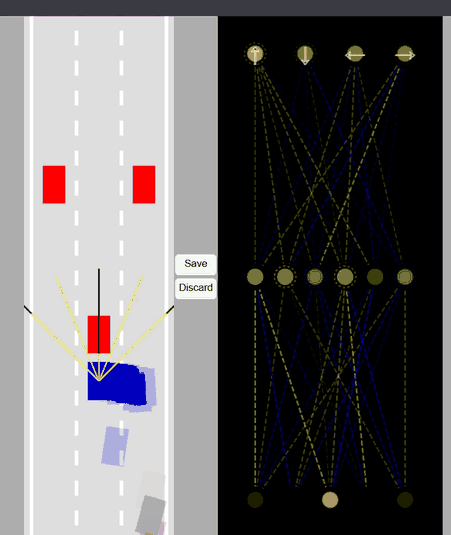

# Self-Driving Car (No Libraries)

**[▶ Live demo](https://stiekex.github.io/self-driving-car/)** — runs in your browser, nothing to install.

A car that learns to drive through traffic, written in plain JavaScript with the
HTML canvas: no frameworks and no ML libraries.

Each car "sees" the road with ray sensors. A small neural network turns those readings
into steering and throttle decisions. Training works like a simple genetic algorithm:
100 cars drive at once, you save the brain of the best one, and the next run starts
from mutated copies of it.

## Demo



## How to run

No install or build step is needed. The easiest way is the
[live demo](https://stiekex.github.io/self-driving-car/). To run it locally:

1. Clone the repo:
   ```bash
   git clone https://github.com/STIEKEX/self-driving-car.git
   ```
2. Open `index.html` in a browser.
   If saving does not persist between refreshes, serve the folder instead
   (for example with the VS Code **Live Server** extension).

## How it works

```
sensors (5 rays) --> neural network --> controls --> car physics --> collision check
       ^                                                                  |
       +-------------------------- next frame ----------------------------+
```

| Part | What it does |
|---|---|
| **Road** | 3 lanes with left and right borders |
| **Car physics** | acceleration, friction, max speed, steering |
| **Collision** | the car is a 4-point polygon, and it is damaged when any edge crosses a road border or a traffic car |
| **Sensors** | 5 rays spread over 90°, each reporting the distance to the closest border or traffic car |
| **Neural network** | 5 inputs → 6 hidden neurons → 4 outputs, with sigmoid activation |
| **Outputs** | forward, reverse, left, right (an output above 0.5 means "press that key") |
| **Visualizer** | draws the best car's network live: yellow = positive weight, blue = negative |

### Sensor inputs

Each ray gives a value between `0` and `1`:
- `0` means nothing is in range
- values close to `1` mean an obstacle is very close

## Training the car

1. Open the page. 100 cars with random brains start driving.
2. The camera follows the **best car**, which is the one that is furthest up the road.
3. When it drives well, click **Save**. Its brain is stored in the browser's `localStorage`.
4. Refresh the page:
   - car 0 gets the saved brain unchanged
   - the other 99 cars get mutated copies (each weight and bias moves 10% toward a random value)
5. Repeat. Click **Discard** to delete the saved brain and start again from random.

**Tip:** don't save a car that is just following a traffic car. It looks like the "best"
car because it never crashes, but its copies will only learn to follow. Save a car that has
actually **overtaken** something.

### Driving it yourself

In `main.js`, change `"AI"` to `"KEYS"` inside `generateCars`, then use the arrow keys.

## Project structure

| File | Purpose |
|---|---|
| `index.html` | page layout: road canvas, Save/Discard buttons, network canvas |
| `style.css` | page styling |
| `main.js` | creates cars and traffic, picks the best car, save/discard, animation loop |
| `car.js` | physics, collision polygon, damage check, connects sensor → brain → controls |
| `sensor.js` | ray casting and readings |
| `network.js` | `NeuralNetwork` and `Level`: feed-forward and mutation |
| `visualizer.js` | draws the network |
| `controls.js` | keyboard, dummy (traffic) and AI control modes |
| `road.js` | road, lanes and borders |
| `utils.js` | `lerp`, segment intersection, polygon intersection, `sigmoid`, colour helper |

## Known limitations

- **Fitness rewards tailgating.** "Best car" means the car furthest up the road, so a car
  that stays behind a traffic car without crashing can look better than one that tried to overtake.
- **Fixed traffic.** Only 3 traffic cars in a fixed layout, so a brain can memorise this road
  instead of learning to drive in general.
- **Manual training.** A person decides when to save, and there is no automatic
  next generation or progress graph yet.
- **Mutation only.** There is no crossover between two good brains.

## Roadmap

- [ ] Rank cars by traffic cars overtaken, with distance as the tie-breaker
- [ ] More traffic, and random traffic layouts
- [ ] On-screen stats (cars alive, overtakes, distance)
- [ ] Automatic generations, plus a graph of best score per generation
- [ ] Test a trained brain on a traffic layout it has never seen
- [ ] Compare against a simple hand-written driving rule as a baseline

## Credits

Based on Radu Mariescu-Istodor's *Self-Driving Car – No Libraries* JavaScript course.
